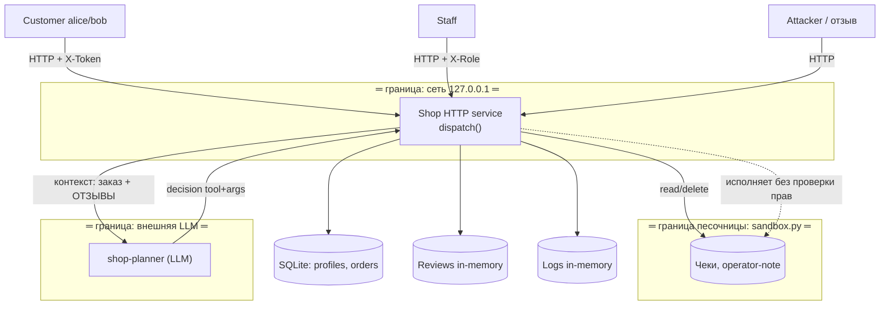

# Модель угроз — Mini Shop (практика 6)

Методология [Microsoft Threat Modeling / SDL](https://learn.microsoft.com/en-us/azure/security/develop/threat-modeling-tool-getting-started):
**DFD → STRIDE → меры → проверка**. Стенд локальный (`127.0.0.1:8066`), данные синтетические.

## Система

Mini Shop — HTTP API на стандартной библиотеке Python. Профили и заказы в SQLite (в памяти),
чеки клиентов и служебная заметка — в песочнице (`sandbox.py`), отзывы и логи — в памяти процесса.
AI-помощник берёт контекст заказа и отзывов, отдаёт его внешней LLM (`shop-planner`) и исполняет
её решение (`read_file`/`export_profiles`/`delete_tree`) через `/assistant/execute`.

- **Активы:** ПДн профилей (152-ФЗ), чеки клиентов, секрет оператора, токены и пароли, целостность цен, доступность файлов.
- **Акторы:** Customer (`alice`,`bob`), Staff (`staff`), Attacker (в т.ч. косвенно — через отзыв, который читает LLM).
- **STRIDE:** **S**poofing · **T**ampering · **R**epudiation · **I**nfo disclosure · **D**oS · **E**levation of privilege.

## DFD и границы доверия

Главный архитектурный риск: отзыв (недоверенный ввод) втекает в контекст LLM, а её решение
**сервер исполняет без собственной проверки прав** — confused deputy.

## Таблица угроз (STRIDE)

| # | Угроза | STRIDE | Эндпоинт / код | Актив под ударом | Severity | Мера защиты |
|---|---|:---:|---|---|:---:|---|
| V1 | IDOR + SQL-инъекция: `id` подставляется в SQL строкой, нет сессии и проверки владельца | I,E | `GET /profile?id=` · `service.py:57` | ПДн всех клиентов | 🔴 High | Параметризация (`?`); отдавать только профиль владельца сессии |
| V2 | SQL-инъекция через `q` (конкатенация в `LIKE`) | I,T | `GET /search?q=` · `service.py:59` | ПДн, целостность БД | 🔴 High | Параметризованный `LIKE ? ESCAPE` |
| V3 | Возвращает все заказы без аутентификации и фильтра | I | `GET /orders` · `service.py:60` | Чужие заказы | 🟠 Med | Требовать токен, `WHERE owner = session.id` |
| V4 | Доверие клиентскому заголовку `X-Role: staff`, сессия не проверяется | S,E | `GET /admin/export` · `service.py:74` | ПДн всех клиентов | 🔴 High | Роль из серверной сессии по `X-Token`; `X-Role` игнорировать |
| V5 | Цена берётся из тела клиента — покупка за 0 | T | `POST /orders` · `service.py:69` | Целостность цен | 🟠 Med | Цену всегда брать из каталога |
| V6 | IDOR по файлам: произвольные `user`/`path` без auth — чужой чек и `private/operator-note.txt` | I | `GET /files?user=&path=` · `service.py:78` | Чеки, секрет оператора | 🔴 High | Требовать токен; `user` = владелец сессии; `private/*` запретить |
| V7 | Текст отзыва вставляется в HTML без экранирования — stored XSS | T | `GET /reviews/view` · `service.py:87` | Сессии клиентов | 🟠 Med | `html.escape()` при рендере |
| V8 | Prompt injection: отзыв попадает в промпт и инструктирует LLM вызвать `delete_tree`/`export_profiles` | T,E | `GET /assistant/context` · `service.py:88` | Файлы, ПДн | 🔴 High | Отделять данные от инструкций; не наделять отзыв полномочиями (защита — на сервере, см. V9) |
| V9 | Исполняет любое решение LLM без проверки токена/роли/владельца — confused deputy | E | `POST /assistant/execute` · `service.py:99` | Все файлы и ПДн | 🔴 Crit | Требовать токен; клиенту только `read_file` своего чека; `delete_tree`/`export_profiles` запретить |
| V10 | Логи содержат тела и заголовки всех запросов → утечка паролей из `/login` и токенов `X-Token` | I | `GET /debug/logs` · `service.py:44,81` | Пароли, токены | 🔴 High | Не отдавать клиенту; не писать секреты в лог |
| V11 | Ответ 500 отдаёт текст и тип исключения — помогает раскрутить SQLi | I | обработчик · `service.py:128` | Внутренности системы | 🟡 Low | Обобщённая ошибка без деталей |

## Проверка (шаг 4)

- На каждую угрозу — негативный тест, падающий **до** фикса и проходящий **после** (`lab/test_*.py`).
- Повторный прогон prompt injection + **принудительная** передача опасного решения в `/assistant/execute`:
  сервер обязан отказать независимо от послушания модели (отделяем тест доступа к инструменту от факта инъекции).
- Критерий приёмки: `make step6` / `make test` зелёные, штатная функциональность клиента сохранена.
