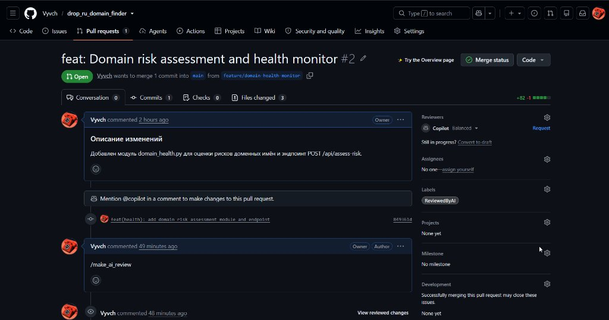
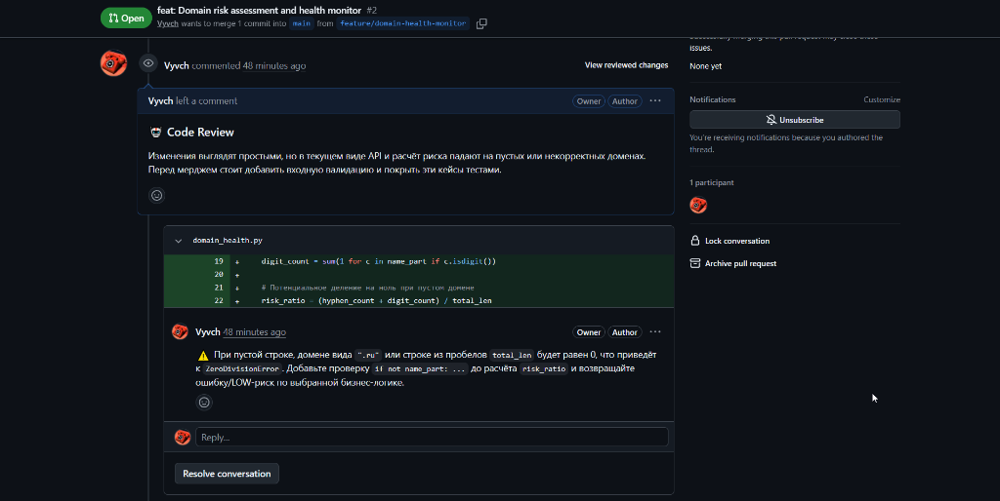
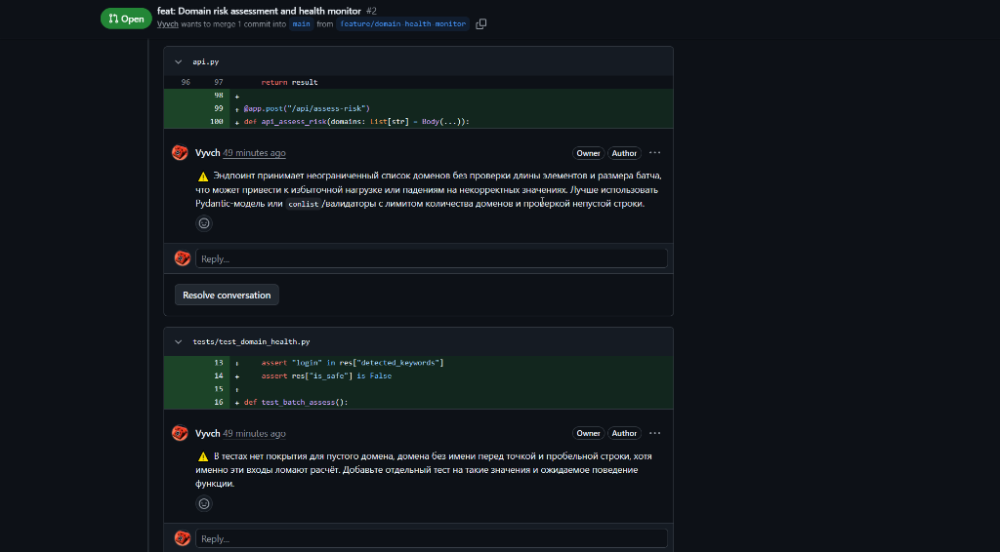
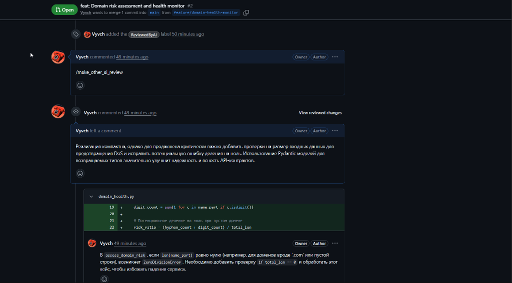
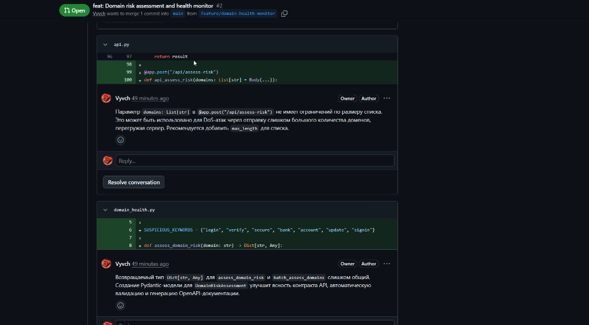
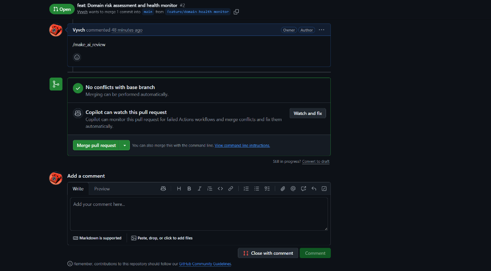
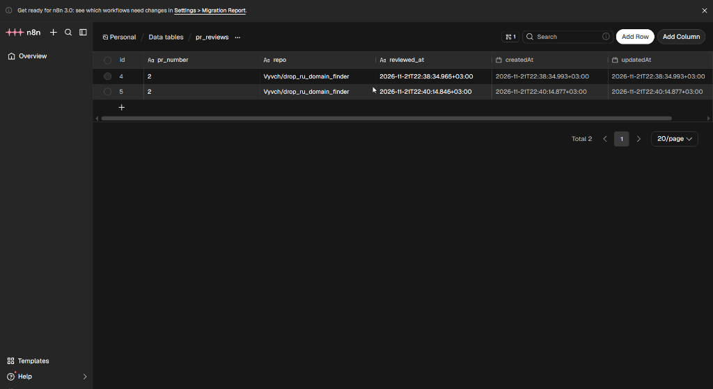

# Отчёт по Практике 7.1: Ассистент для код-ревью в n8n (12 / 12 баллов)

* **Студент:** Владислав Пивцаев (Vyvch)
* **Репозиторий с целевым проектом:** [https://github.com/Vyvch/drop_ru_domain_finder](https://github.com/Vyvch/drop_ru_domain_finder)
* **Тестовый Pull Request с ревью:** [https://github.com/Vyvch/drop_ru_domain_finder/pull/2](https://github.com/Vyvch/drop_ru_domain_finder/pull/2)
* **Экспорт сценария:** [`n8n_review_workflow.json`](./n8n_review_workflow.json)

---

## Хроника выполнения и подтверждение всех критериев (12 из 12 баллов)

### 1. Открытие PR и запуск основной модели (Критерий 4, «со звёздочкой» — 5 баллов)
В PR #2 отправлен комментарий `/make_ai_review`. Воркфлоу n8n автоматически обработал diff, выставил лейбл `ReviewedByAI` и опубликовал точечные замечания:

* **Общий вид PR и вызов команды:**


* **Компактный вердикт (summary) и точечный комментарий к строке 22 (`ZeroDivisionError`):**


* **Точечные комментарии к валидации в `api.py` и краевым случаям в `tests/test_domain_health.py`:**


---

### 2. Запуск второй модели через `/make_other_ai_review` (Критерий 1 — 2 балла)
По команде `/make_other_ai_review` вызвана альтернативная модель (`DeepSeek`), которая провела независимый архитектурный анализ надежности и безопасности:

* **Вызов `/make_other_ai_review`, вердикт второй модели и точечный комментарий:**


* **Точечные комментарии второй модели к DoS-рискам в `api.py` и типизации Pydantic:**


---

### 3. Проверка дедупликации (Критерий 3 — 3 балла)
В PR #2 повторно отправлена команда `/make_ai_review`. Нода `Check Data Table (Deduplication)` нашла запись в Data Table, отфильтровала событие (`0 items`) и остановила выполнение сценария. Повторное ревью проигнорировано:



---

### 4. Содержимое Data Table (Критерий 2 — 2 балла)
В таблице `pr_reviews` зафиксированы успешные проверки PR #2 с отметками времени и именем репозитория:



---

## Архитектурная схема n8n (DRY)

```text
GitHub Trigger (PR comment / PR open)
                  │
                  ▼
      Route by Command (Switch)
       │                     │
       │ [0: other]          │ [1: normal /make_ai_review]
       │                     ▼
       │          Check Data Table (Deduplication)
       │                     │
       └──────────┬──────────┘  <-- /make_other_ai_review идет в обход дедупликации!
                  ▼
      Get PR Details (head.sha)
                  │
                  ▼
             Get PR Diff
                  │
                  ▼
     Parse Diff & Number Lines
                  │
                  ▼
            Which Model? (If)
             ├─► Primary Reviewer (GPT-4o-mini) ──┐
             └─► Secondary Reviewer (DeepSeek) ───┤
                                                  ▼
                                    Format GitHub Review Payload
                                                  │
                                                  ▼
                                  Submit Inline Review (GitHub API)
                                                  │
                                                  ▼
                                       Record PR in Data Table
                                                  │
                                                  ▼
                                        Add ReviewedByAI Label
```
