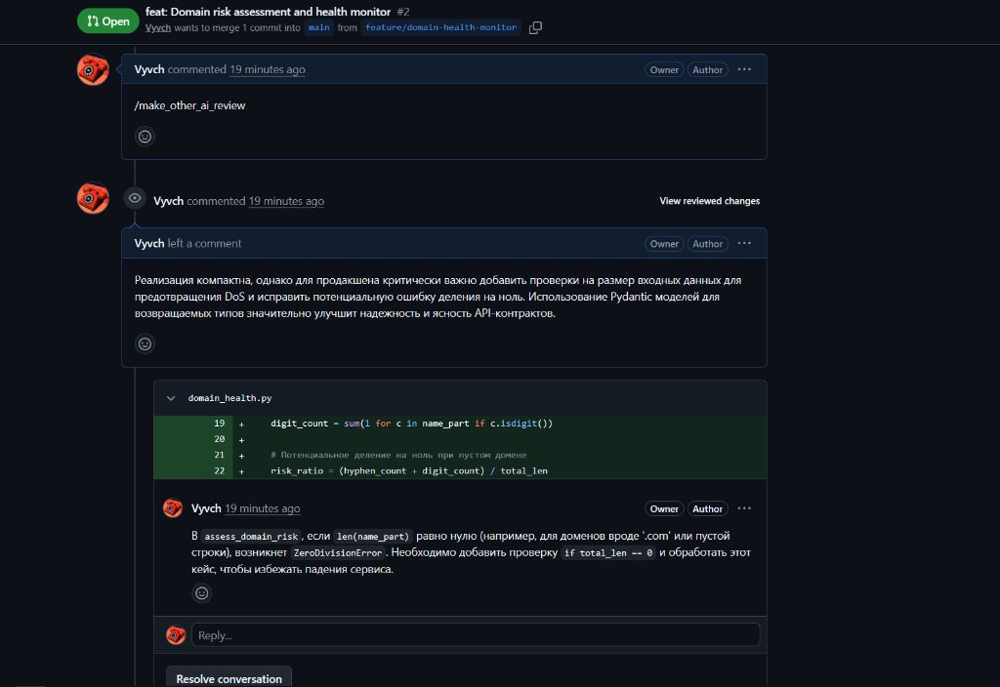
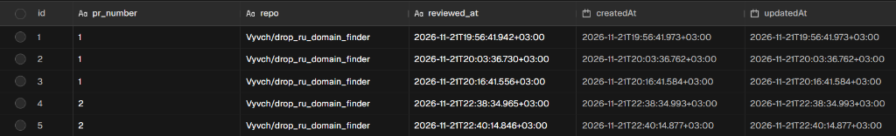
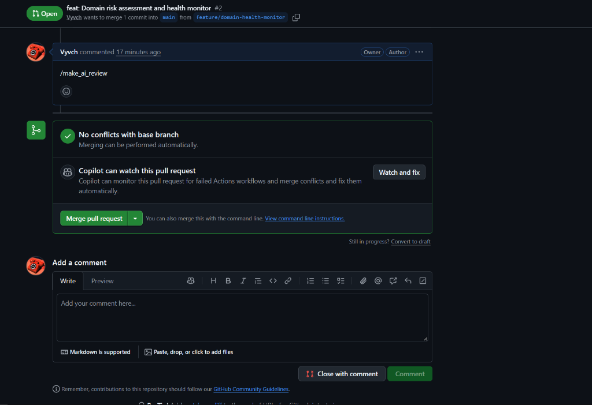
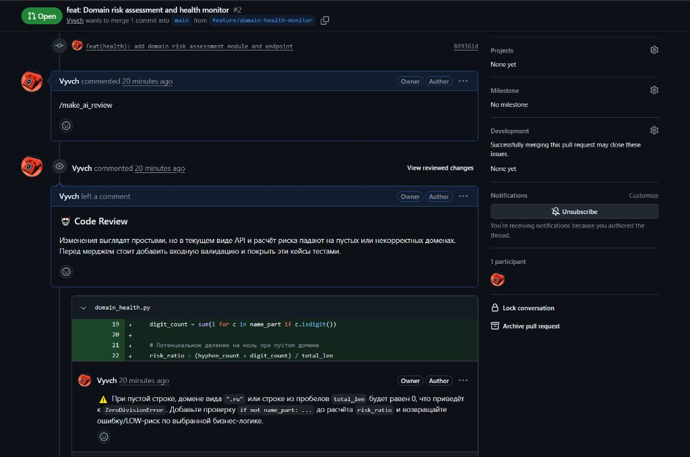

# Отчёт по Практике 7.1: Ассистент для код-ревью в n8n (12 / 12 баллов)

* **Студент:** Владислав Пивцаев (Vyvch)
* **Репозиторий с целевым проектом:** [https://github.com/Vyvch/drop_ru_domain_finder](https://github.com/Vyvch/drop_ru_domain_finder)
* **Тестовый Pull Request с ревью:** [https://github.com/Vyvch/drop_ru_domain_finder/pull/2](https://github.com/Vyvch/drop_ru_domain_finder/pull/2)
* **Экспорт сценария:** [`n8n_review_workflow.json`](./n8n_review_workflow.json)

---

## Подтверждение выполнения всех критериев (12 из 12 баллов)

### 1. Критерий 1: Команда `/make_other_ai_review` со второй моделью (2 балла)
Команда `/make_other_ai_review` запускает альтернативное код-ревью с помощью второй модели (`deepseek/deepseek-chat` / `gemini`), публикуя результат отдельным ревью в PR.



---

### 2. Критерий 2: Интеграция с Data Table (2 балла)
Создана Data Table `pr_reviews`, в которую после каждого успешного ревью сохраняется запись с номером PR, репозиторием и таймстемпом.



---

### 3. Критерий 3: Дедупликация повторных вызовов (3 балла)
При повторном вызове `/make_ai_review` на уже проверенный PR нода `Check Data Table (Deduplication)` находит существующую запись в `pr_reviews`, возвращает `0 items` и останавливает сценарий. Повторный комментарий полностью игнорируется:



---

### 4. Критерий 4 («Со звёздочкой»): Точечные inline-комментарии к коду diff (5 баллов)
Комментарии публикуются не в виде общего текста, а точечно — с привязкой к конкретным строкам diff через официальный GitHub Reviews API (`POST /pulls/{number}/reviews`).

* **Первичное ревью (GPT-4o-mini) с инлайн-замечанием к строке 22:**


* **Альтернативное ревью (Вторая модель) с инлайн-замечанием к строкам 19-22:**


---

## Архитектура сценария (DRY)

```text
GitHub Trigger
      │
      ▼
Route by Command (Switch)
 ├─ [0: /make_other_ai_review] ──┐
 └─ [1: /make_ai_review] ───────► Check Data Table (Deduplication)
                                       │
                                       ▼
                             Get PR Details (head.sha)
                                       │
                                       ▼
                                  Get PR Diff
                                       │
                                       ▼
                            Parse Diff & Number Lines
                                       │
                                       ▼
                                 Which Model? (If)
                                  ├─► Primary Reviewer (GPT-4o-mini) ──┐
                                  └─► Secondary Reviewer (DeepSeek) ───┤
                                                                       ▼
                                                         Format GitHub Review Payload
                                                                       │
                                                                       ▼
                                                       Submit Inline Review (GitHub API)
                                                                       │
                                                                       ▼
                                                            Record PR in Data Table
                                                                       │
                                                                       ▼
                                                             Add ReviewedByAI Label
```
