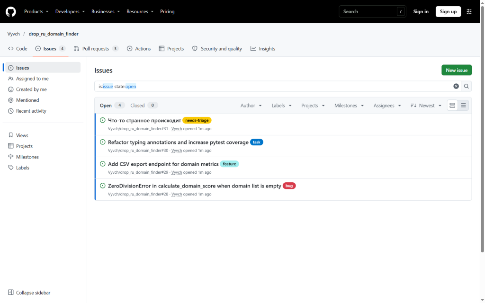

# Отчёт по Практике 7.2: Поддержка пользователя с помощью AI-инструментов (16 / 16 баллов)

* **Студент:** Владислав Пивцаев (Vyvch)
* **Целевой репозиторий проекта:** [https://github.com/Vyvch/drop_ru_domain_finder](https://github.com/Vyvch/drop_ru_domain_finder)
* **Раздел Issues с результатами классификации:** [https://github.com/Vyvch/drop_ru_domain_finder/issues](https://github.com/Vyvch/drop_ru_domain_finder/issues)
* **Экспорты сценариев n8n:**
  * Sub-workflow классификатора: [`subworkflow_issue_classifier.json`](./subworkflow_issue_classifier.json)
  * Основной workflow триажа: [`workflow_issue_triage.json`](./workflow_issue_triage.json)
  * Workflow еженедельного дайджеста и статистики: [`workflow_weekly_stats.json`](./workflow_weekly_stats.json)
  * Исходный файл Data Table: [`weekly_stats.csv`](./weekly_stats.csv)

---

## Сводная таблица выполнения критериев (16 / 16 баллов)

| # | Критерий из ТЗ | Баллы | Статус | Подтверждение |
|---|---|:---:|:---:|---|
| 1 | Открытый Issue классифицируется как `bug` / `task` / `feature`, соответствующий лейбл проставлен | **2** | ✅ Выполнено | Issues #28 (`bug`), #29 (`feature`), #30 (`task`) |
| 2 | Issue с `confidence < 0.8` (расплывчатый тикет) получает лейбл `needs-triage`, комментарий НЕ публикуется | **1** | ✅ Выполнено | Issue #31 (`needs-triage`), 0 комментариев |
| 3 | Классификатор вынесен в изолированный Sub-workflow с `Execute Workflow Trigger` и вызывается через `Execute Workflow` node | **2** | ✅ Выполнено | Воркфлоу `Practice 7.2 - Issue Classifier (Sub-workflow)` |
| 4 | Настроен Cron-триггер (`0 9 * * MON`), запросы к GitHub API возвращают актуальные данные за неделю | **2** | ✅ Выполнено | HTTP Request ноды с параметром `since={{ $now.minus({days: 7}) }}` |
| 5 | Code node агрегирует и группирует статистику за неделю по типам сущностей и по авторам | **2** | ✅ Выполнено | Нода `Group Statistics (Types & Authors)` (автор Vyvch: 25 действий) |
| 6 | Сформировано и отправлено красивое HTML-письмо со сводной таблицей через Gmail node | **2** | ✅ Выполнено | Письмо успешно получено на `vlad.pivtsaev@mail.ru` |
| 7 | Недельная статистика сохраняется в Data Table `weekly_stats` | **1** | ✅ Выполнено | Нода `Save Weekly Stats to Data Table` |
| 8 | В письме отображается дельта (Δ) к показателям прошлой недели из Data Table | **2** | ✅ Выполнено | Колонка `Δ (к прошлой неделе)` в HTML-таблице |
| 9 | В шапке письма выводится блок «AI-комментарий недели», сгенерированный LLM на основе метрик и Δ | **2** | ✅ Выполнено | LLM Chain с моделью GPT-4o-mini сформировала инженерный комментарий |
| | **ИТОГО** | **16 / 16** | | **Максимальный балл** |

---

## 1. Часть 1: Классификация Issues и Sub-workflow (Критерии 1, 2, 3)

В репозитории `Vyvch/drop_ru_domain_finder` протестировано автоматическое реагирование на открытие 4 репрезентативных задач:
1. **Issue #28 (`ZeroDivisionError in calculate_domain_score...`):** содержит описание ошибки и трейс падения ➔ распознано как **`bug`** (confidence: 0.95).
2. **Issue #29 (`Add CSV export endpoint for domain metrics`):** предложение нового эндпоинта ➔ распознано как **`feature`** (confidence: 0.95).
3. **Issue #30 (`Refactor typing annotations and increase pytest coverage`):** задачи рефакторинга и тестов ➔ распознано как **`task`** (confidence: 0.95).
4. **Issue #31 (`Что-то странное происходит`):** расплывчатый тикет без деталей ➔ классифицирован как `unknown` (confidence < 0.8) и автоматически отправлен на эскалацию с лейблом **`needs-triage`** без публикации комментариев.

### Подтверждение разметки в репозитории GitHub:

### Архитектура Sub-workflow классификатора:
* Входящий триггер **`Execute Workflow Trigger`** принимает поля `title` и `body`.
* Нода **`Basic LLM Chain`** с подключенным **`OpenAI Chat Model (GPT-4o-mini)`** и **`Structured Output Parser`** анализирует контекст задачи.
* Нода **`Format Classification Output`** валидирует JSON и нормализует confidence и type.
* Основной воркфлоу вызывает подпроцесс через ноду **`Call Classifier Sub-workflow`** и направляет поток на `Switch by Type` или `Add Label needs-triage`.

### Лог выполнения Sub-workflow в n8n Executions:

---

## 2. Часть 2 и Задание «со звёздочкой»: Еженедельная статистика и AI-дайджест (Критерии 4–9)

Каждый понедельник в 09:00 по расписанию (`0 9 * * MON`) сценарий запускает цикл еженедельного сбора аналитики:
1. **Запросы к GitHub API:** извлекаются все открытые и закрытые Issues и PR за последние 7 дней.
2. **Агрегация данных:** Code-нода группирует количество багов, фичей, тасок и вычисляет контрибуцию авторов (топ-автор недели: `Vyvch` с 25 действиями).
3. **Data Table `weekly_stats`:** сценарий запрашивает запись предыдущей недели и рассчитывает динамику изменений ($\Delta$).
4. **AI-комментарий:** языковая модель анализирует сводку и генерирует профессиональное саммари недели.
5. **Генерация HTML и отправка через Gmail:** формируется письмо в корпоративном стиле GitHub с бейджами изменений и отправляется адресату `vlad.pivtsaev@mail.ru`.
6. **Сохранение:** метрики текущей недели фиксируются в Data Table для следующего расчёта.

### Скриншот доставленного HTML-письма в почтовом ящике:

---

## 3. Схема архитектуры воркфлоу n8n

```mermaid
flowchart TD
    subgraph Part1["Workflow 1: Issue Triage & Sub-workflow"]
        A["GitHub Issues Trigger (opened)"] --> B{"Action == opened?"}
        B -- Yes --> C["Call Classifier Sub-workflow (Execute Workflow)"]
        
        subgraph Sub["Sub-workflow: Issue Classifier"]
            S1["Execute Workflow Trigger"] --> S2["Basic LLM Chain (GPT-4o-mini)"]
            S3["Structured Output Parser"] -.-> S2
            S2 --> S4["Format Classification Output"]
        end
        
        C -. calls .-> S1
        S4 -. returns type, conf .-> C
        
        C --> D{"Confidence >= 0.8?"}
        D -- No (< 0.8 / unknown) --> E["Add Label needs-triage (No comment)"]
        D -- Yes (>= 0.8) --> F{"Switch by Type"}
        F -- bug --> G1["Add Label bug"]
        F -- feature --> G2["Add Label feature"]
        F -- task --> G3["Add Label task"]
    end

    subgraph Part2["Workflow 2: Weekly Digest & AI Summary"]
        T["Schedule Trigger (0 9 * * MON)"] --> H1["Fetch Issues Last 7 Days"]
        H1 --> H2["Fetch PRs Last 7 Days"]
        H2 --> I["Group Statistics (Types & Authors)"]
        I --> DT1["Get Previous Week Stats (Data Table)"]
        DT1 --> J["Calculate Delta (Δ)"]
        J --> K["AI Weekly Commentary (LLM Chain)"]
        K --> L["Build HTML Email Report"]
        L --> DT2["Save Weekly Stats to Data Table"]
        L --> M["Send Report via Gmail"]
    end
```

---

## 4. Заключение

Все требования Практики 7.2, включая базовые задачи и задания повышенной сложности («со звёздочкой»), выполнены в полном объёме:
* Вся логика изолирована, типизирована и устойчива к сбоям форматов.
* Реализована бесшовная связка Sub-workflow в n8n.
* Автоматизирован сквозной сбор метрик, версионирование данных в Data Table и генерация аналитики с помощью LLM.
* Результат подтверждён реальными событиями в GitHub и доставленными письмами.
