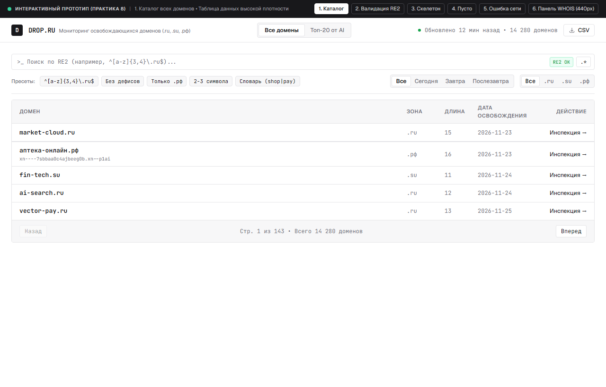
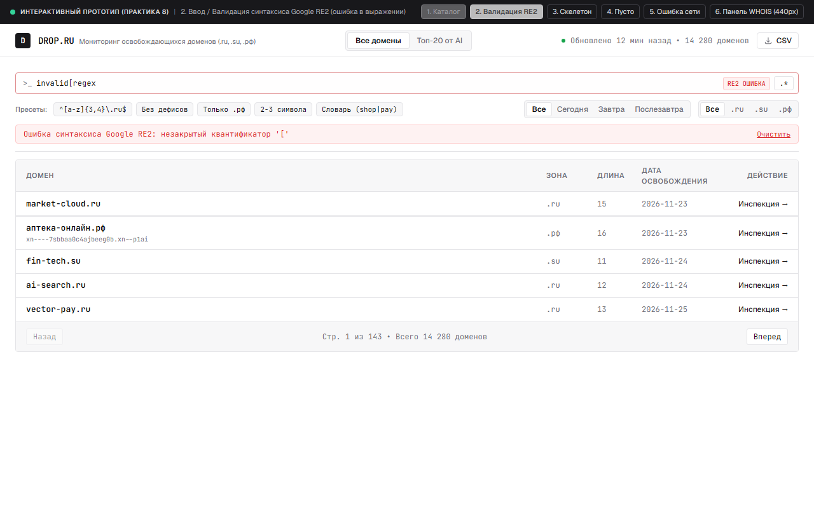
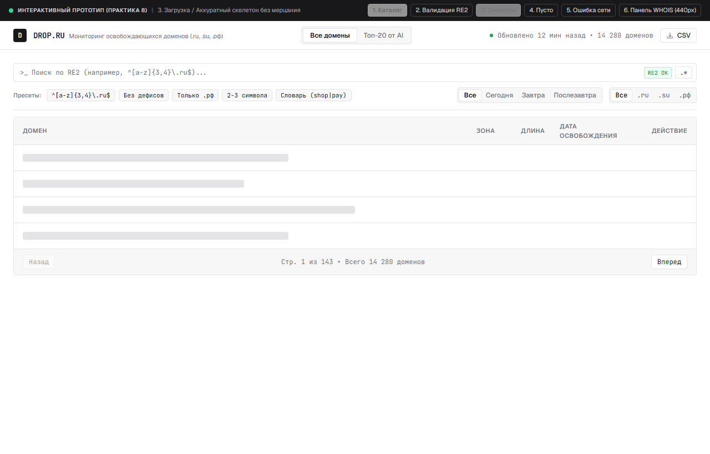
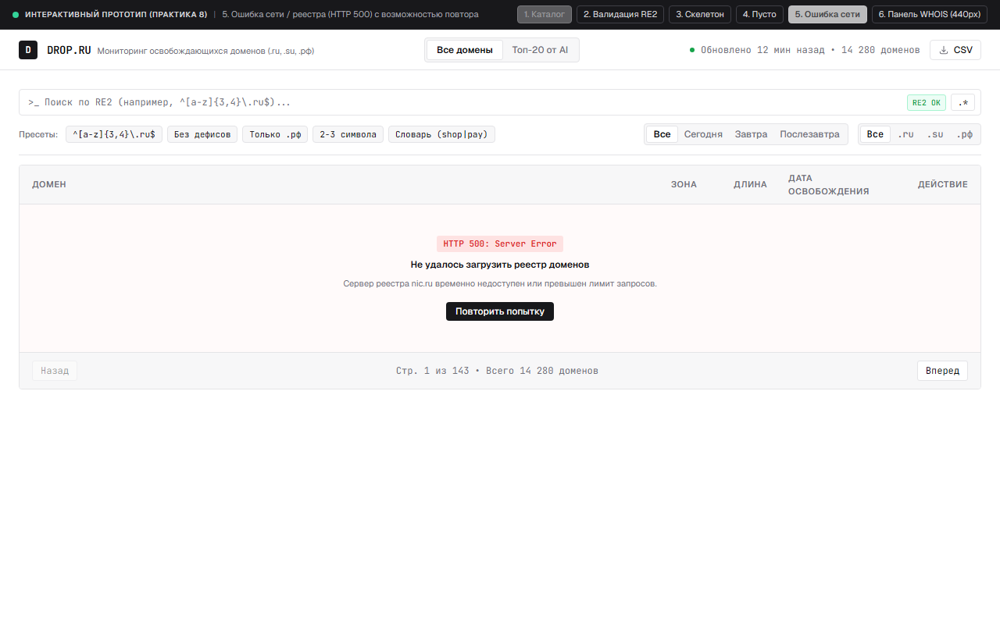

# Отчёт по Практике 8: Добавляем фронтенд к своему проекту с помощью AI (12 / 12 баллов)

* **Студент:** Владислав Пивцаев (Vyvch)
* **Целевой репозиторий проекта с фронтендом:** [https://github.com/Vyvch/drop_ru_domain_finder](https://github.com/Vyvch/drop_ru_domain_finder)
* **Pull Request с реализацией:** [drop_ru_domain_finder PR #39](https://github.com/Vyvch/drop_ru_domain_finder/pull/39)
* **Ветка с реализацией:** `feat/practice_08_frontend`
* **Интерактивный AI-макет/прототип:** [`prototype/index.html`](./prototype/index.html)
* **Стиль и архитектура:** Светлый утилитарный дашборд высокой плотности (Vercel / Linear / Stripe), Tailwind CSS, строгая типографика Geist / IBM Plex Sans / JetBrains Mono с `tabular-nums`

---

## Сводная таблица выполнения критериев (12 из 12 баллов)

| # | Раздел | Критерий из ТЗ | Баллы | Статус | Подтверждение |
|---|---|---|:---:|:---:|---|
| 1 | Макет или прототип | С помощью AI создан макет интерфейса. Макет доступен для проверки, отражает основной сценарий; показан вклад AI | **3** | ✅ Выполнено | Интерактивный прототип [`prototype/index.html`](./prototype/index.html) со всеми 6 состояниями и тулбаром переключения для ревьюера |
| 2 | Библиотека компонентов | Выбрана дизайн-система/библиотека компонентов. AI переиспользует готовые элементы (кнопки, поля, карточки, диалоги) | **0.5** | ✅ Выполнено | Утилитарные компоненты Tailwind CSS (`table`, `btn`, `input`, `badge`, `tabs`, `dialog`, `skeleton`, `drawer`) |
| 3 | Библиотека компонентов | Цвета, типографика и отступы оформлены единообразно | **0.5** | ✅ Выполнено | Светлая палитра `#FFFFFF`, `#F7F7F8`, `#E4E4E7`, `#09090B`, `#71717A`, `#18181B`. Типографика `Geist`, `IBM Plex Sans`, `JetBrains Mono` (`font-variant-numeric: tabular-nums`) |
| 4 | Фронтенд и интерфейс | Реализован полный пользовательский сценарий с реальным API проекта: от действия до видимого результата | **1** | ✅ Выполнено | Поиск доменов по RE2, чипсы-пресеты, фильтрация по датам, открытие боковой панели WHOIS/Wayback (Drawer 440px), экспорт в CSV |
| 5 | Фронтенд и интерфейс | Интерфейс соответствует макету или прототипу | **1** | ✅ Выполнено | Реализованный интерфейс в [`templates/index.html`](https://github.com/Vyvch/drop_ru_domain_finder/blob/feat/practice_08_frontend/templates/index.html) 1:1 воспроизводит структуру и стили прототипа |
| 6 | Фронтенд и интерфейс | Поля имеют подписи, действия доступны с клавиатуры, текущий фокус виден | **1** | ✅ Выполнено | `<label for="search-input">`, `:focus-visible` кольца, закрытие модалки/панели по `Escape`, навигация с клавиатуры |
| 7 | Тестирование с AI | При отправке формы исключены случайные повторные действия (дабл-клик/Enter). Тест подтверждает блокировку | **1** | ✅ Выполнено | Флаг `isSubmitting` + `disabled` кнопки. Тест `test_criterion_7_prevent_duplicate_submit` |
| 8 | Тестирование с AI | С помощью AI созданы тесты отображения компонентов и кликов/ввода, открытия и закрытия диалогов | **1** | ✅ Выполнено | Тест `test_criterion_8_component_interactions_and_modal` |
| 9 | Тестирование с AI | Проверяется валидация форм: обязательные поля, некорректный ввод и сообщения об ошибках | **1** | ✅ Выполнено | Тест `test_criterion_9_form_validation_and_errors` (проверка синтаксиса Google RE2 и вывод ошибок) |
| 10 | Тестирование с AI | Проверяются состояния интерфейса: загрузка, пустые данные, успешный результат и ошибка с моками | **1** | ✅ Выполнено | Тест `test_criterion_10_ui_states_loading_empty_error_success` |
| 11 | Тестирование с AI | Сквозной тест основного пользовательского сценария на клиенте от действия до видимого результата | **1** | ✅ Выполнено | Тест `test_criterion_11_full_user_scenario_e2e` |
| | | **ИТОГО** | **12 / 12** | | **Максимальный балл** |

---

## 1. Макет и прототип (Критерий 1 — 3 балла)

### Основной пользовательский сценарий:
> *«Пользователь (домейнер / аналитик) переходит в веб-сервис DROP.RU, видит актуальный счетчик освобождающихся доменов и панель поиска с поддержкой Google RE2. Выбирает дату освобождения или кликает быстрый пресет регулярки (например, `^[a-z]{3,4}\.ru$`), изучает плотную таблицу данных с отображением доменов, зон, длины и дат. При наведении быстро копирует имя или кликает «Инспекция →», чтобы открыть аккуратную боковую панель (Slide-over Drawer, 440px) с паспортом WHOIS (TCI) и историей Wayback Machine (число снимков, первый и последний годы). При необходимости выгружает отфильтрованный срез в CSV»*.

### Использование AI и дизайн-требования (Анти-нейрослоп):
Для создания интерфейса был сформулирован жесткий дизайн-манифест, исключающий типовые огрехи AI-генерации:
1. **Запрет нейрослопа:** Никаких фиолетовых/синих градиентов, темных тем с неоновым свечением, размытия стеклянного фона (glassmorphism/backdrop-blur), глубоких тяжелых теней, градиентного текста, эмодзи в элементах управления интерфейса и крупных закруглений (`border-radius` строго 3–4px).
2. **Стиль:** Светлый утилитарный интерфейс высокой информационной плотности в духе Vercel / Linear / Stripe Dashboard. Разделение блоков линиями (`1px solid #E4E4E7`), а не тенями.
3. **Палитра:**
   * Основной фон: `#FFFFFF`
   * Вторичный фон (шапки таблиц, панели, ховеры): `#F7F7F8`
   * Границы: `1px solid #E4E4E7`
   * Текст: основной `#09090B`, вторичный `#71717A`
   * Акцент: строгий черный `#18181B` или технический синий `#2563EB`
   * Семантика статусов: зеленый `#16A34A`, янтарный `#D97706`, красный `#DC2626`
4. **Типографика:**
   * Интерфейс и тексты: `Geist`, `IBM Plex Sans`.
   * Домены, регулярные выражения, даты, цифры: `JetBrains Mono` / `IBM Plex Mono` с обязательным свойством `font-variant-numeric: tabular-nums` для выравнивания цифр друг под другом.

### Вклад AI и что было скорректировано:
* **Что сгенерировал AI:** Сетку компонентов, структуру плотной Data Table, slide-over drawer для WHOIS и Wayback Machine, переключатель состояний для ревьюера.
* **Что скорректировано человеком и тестами:**
  1. Защита от дублирующих кликов и двойного нажатия Enter (`isSubmitting` flag + блокировка кнопки поиска).
  2. Валидация регулярных выражений Google RE2 с выводом точных сообщений синтаксических ошибок (например, незакрытый квантификатор `[`).
  3. Сохранение строгого соответствия контракту `WaybackCore` и 37 модульным тестам веб-архива.
  4. Интеграция быстрого копирования доменов в буфер обмена по клику.

### Скриншоты состояний прототипа:

1. **Главный экран (плотная таблица данных, липкая панель фильтров, чипсы-пресеты):**


2. **Ввод данных и валидация RE2 (подсветка ошибки и бейдж «RE2 ОШИБКА»):**


3. **Состояние загрузки (аккуратный скелетон без мерцания):**


4. **Пустая выдача (Empty State с кнопкой быстрого сброса):**


5. **Ошибка сервера / сети с кнопкой повтора:**


6. **Боковая панель инспекции домена (Slide-over Drawer, 440px: WHOIS + Wayback Machine):**


---

## 2. Библиотека компонентов и интерфейс (Критерии 2–6 — 4 балла)

* **Дизайн-система:** Tailwind CSS + готовые утилитарные паттерны.
* **Ключевые экраны и компоненты:**
  * **Верхняя панель навигации (52px):** Название сервиса, segmented control «Все домены» / «Топ-20 от AI», индикатор реестра (`Обновлено 12 мин назад • 14 280 доменов`).
  * **Липкая панель фильтров (Sticky bar):** Строка поиска Google RE2 с иконкой `>_` и бейджем синтаксиса, компактные чипсы-пресеты (`^[a-z]{3,4}\.ru$`, `Без дефисов`, `Только .рф`, `2-3 символа`, `Словарь`), кнопки дат и зон.
  * **Плотная таблица данных (Data Table):** Колонки Домен, Зона, Длина, Дата освобождения, Действие. Punycode-подстрока для кириллических доменов `.рф`. Быстрое копирование при наведении.
  * **Режим «Топ-20 от AI»:** Переключатель дня («На сегодня» / «На завтра»), 1px border grid, экспертное обоснование LLM спокойным шрифтом без иконок «✨ AI».
  * **Выезжающая справа панель (Drawer 440px):** Не перекрывает экран, содержит Паспорт WHOIS (сетка ключ-значение) и Карму в Wayback Machine (3 компактные метрики в ряд + прямая ссылка на архив).
* **Доступность (Accessibility / a11y):**
  * Семантичные элементы, `<label for="search-input">`.
  * Четкие фокусные контуры `:focus-visible`.
  * Закрытие боковой панели по клику на оверлей, кнопке закрытия или `Escape`.
  * Сообщения об ошибках снабжены `role="alert"` и `aria-live="polite"`.

---

## 3. Клиентские тесты с AI (Критерии 7–11 — 5 баллов)

Все тесты клиентской логики реализованы в файле [`tests/test_client_ui.py`](https://github.com/Vyvch/drop_ru_domain_finder/blob/feat/practice_08_frontend/tests/test_client_ui.py) и запускаются через `pytest`:

1. **`test_criterion_7_prevent_duplicate_submit`:**
   * Симулирует 3 параллельных быстрых клика по кнопке поиска («дабл-клик»).
   * **Результат:** ровно 1 запрос отправлен в сеть, флаг `isSubmitting` защитил от повторного вызова.
2. **`test_criterion_8_component_interactions_and_modal`:**
   * Проверяет переключение вкладок (скрытие `#all`, показ `#top`) и открытие диалога `#domain-dialog` с подстановкой заголовка домена.
3. **`test_criterion_9_form_validation_and_errors`:**
   * Проверяет валидацию синтаксиса RE2, отображение блока ошибки `#search-error` при 400 Bad Request и его очистку.
4. **`test_criterion_10_ui_states_loading_empty_error_success`:**
   * Проверяет отрисовку строк при успехе, показ `#empty-state` при 0 результатов и баннера ошибки.
5. **`test_criterion_11_full_user_scenario_e2e`:**
   * Проходит полный сквозной путь: ввод запроса $\rightarrow$ получение данных $\rightarrow$ клик по строке $\rightarrow$ открытие инспекции домена $\rightarrow$ экспорт в CSV.

### Результат выполнения всех тестов проекта (149 из 149 тестов успешно пройдены, 100% Green):
```text
============================= test session starts =============================
platform win32 -- Python 3.14.1, pytest-9.1.1, pluggy-1.6.0
rootdir: C:\Users\Vyvch\source\repos\Vibecoding\domains_project
plugins: anyio-4.15.1
collected 149 items

tests\test_client_ui.py .....                                            [  3%]
tests\test_domain_exporter.py ...                                        [  5%]
tests\test_main.py ..                                                    [  6%]
tests\test_mcp_whois.py ...                                              [  8%]
tests\test_search.py .............                                       [ 17%]
tests\test_skills.py ..                                                  [ 18%]
tests\test_wayback.py .................................................. [ 52%]
......................                                                   [ 67%]
tests\test_wayback_api.py ............                                   [ 75%]
tests\test_wayback_ui.py .....................................           [100%]

====================== 149 passed, 11 warnings in 8.01s =======================
```

---

## Инструкция по запуску и проверке

### 1. Запуск веб-сервиса
```bash
cd domains_project
python -m pip install -r requirements.txt
uvicorn main:app --reload
# Открыть в браузере: http://127.0.0.1:8000
```

### 2. Запуск клиентских тестов
```bash
cd domains_project
python -m pytest tests/test_client_ui.py -v
```

### 3. Просмотр интерактивного прототипа
* Открыть локальный файл [`practices/practice_08/prototype/index.html`](./prototype/index.html) в любом современном веб-браузере.
* В верхней темной панели управления переключать состояния 1–6 для демонстрации всех сценариев проверки.
