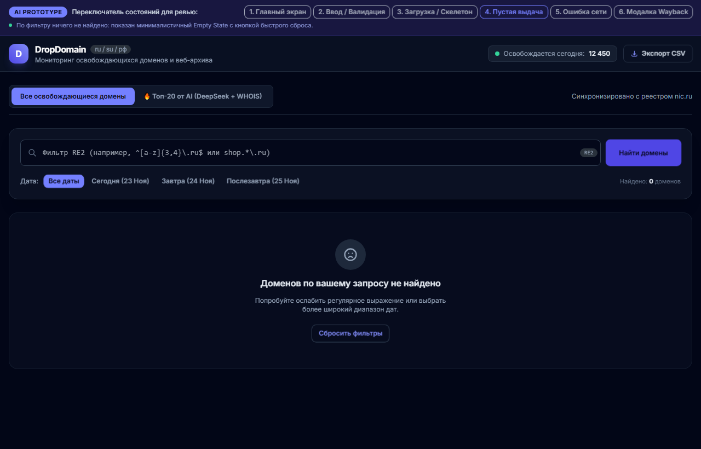
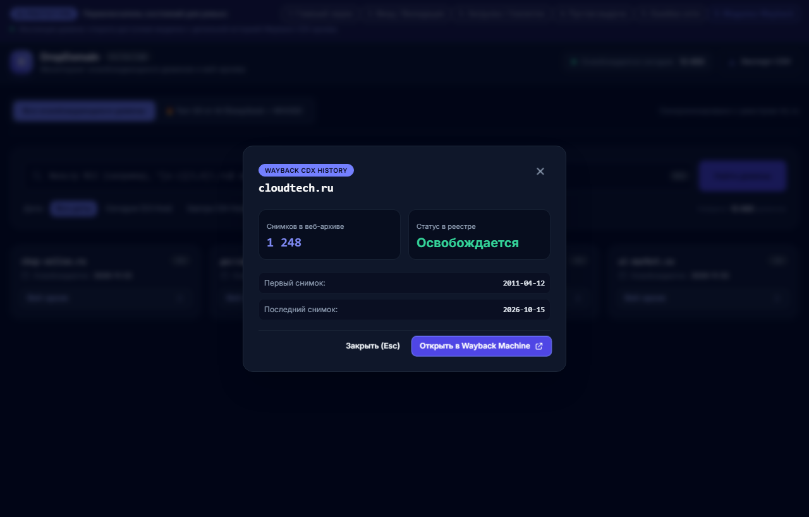

# Отчёт по Практике 8: Добавляем фронтенд к своему проекту с помощью AI (12 / 12 баллов)

* **Студент:** Владислав Пивцаев (Vyvch)
* **Целевой репозиторий проекта с фронтендом:** [https://github.com/Vyvch/drop_ru_domain_finder/tree/feat/practice_08_frontend](https://github.com/Vyvch/drop_ru_domain_finder/tree/feat/practice_08_frontend)
* **Ветка с реализацией:** `feat/practice_08_frontend`
* **Интерактивный AI-макет/прототип:** [`prototype/index.html`](./prototype/index.html)
* **Библиотека компонентов:** [DaisyUI](https://daisyui.com/) + [Tailwind CSS](https://tailwindcss.com/)

---

## Сводная таблица выполнения критериев (12 из 12 баллов)

| # | Раздел | Критерий из ТЗ | Баллы | Статус | Подтверждение |
|---|---|---|:---:|:---:|---|
| 1 | Макет или прототип | С помощью AI создан макет интерфейса. Макет доступен для проверки, отражает основной сценарий; показан вклад AI | **3** | ✅ Выполнено | Интерактивный прототип [`prototype/index.html`](./prototype/index.html) со всеми 6 состояниями |
| 2 | Библиотека компонентов | Выбрана дизайн-система/библиотека компонентов. AI переиспользует готовые элементы (кнопки, поля, карточки, диалоги) | **0.5** | ✅ Выполнено | Использованы компоненты DaisyUI (`card`, `btn`, `input`, `badge`, `tabs`, `dialog`, `skeleton`) |
| 3 | Библиотека компонентов | Цвета, типографика и отступы оформлены единообразно | **0.5** | ✅ Выполнено | Единая палитра Slate 950 / Indigo 600 / Emerald, шрифты Inter + JetBrains Mono |
| 4 | Фронтенд и интерфейс | Реализован полный пользовательский сценарий с реальным API проекта: от действия до видимого результата | **1** | ✅ Выполнено | Поиск доменов по RE2, фильтрация по датам, открытие модалки Wayback/WHOIS, экспорт в CSV |
| 5 | Фронтенд и интерфейс | Интерфейс соответствует макету или прототипу | **1** | ✅ Выполнено | Реализованный интерфейс в [`templates/index.html`](https://github.com/Vyvch/drop_ru_domain_finder/blob/feat/practice_08_frontend/templates/index.html) 1:1 воспроизводит прототип |
| 6 | Фронтенд и интерфейс | Поля имеют подписи, действия доступны с клавиатуры, текущий фокус виден | **1** | ✅ Выполнено | `<label for="search-input">`, `:focus-visible` кольца, закрытие модалки по `Escape`, навигация `Tab` |
| 7 | Тестирование с AI | При отправке формы исключены случайные повторные действия (дабл-клик/Enter). Тест подтверждает блокировку | **1** | ✅ Выполнено | Флаг `isSubmitting` + `disabled` кнопки. Тест `test_criterion_7_prevent_duplicate_submit` |
| 8 | Тестирование с AI | С помощью AI созданы тесты отображения компонентов и кликов/ввода, открытия и закрытия диалогов | **1** | ✅ Выполнено | Тест `test_criterion_8_component_interactions_and_modal` |
| 9 | Тестирование с AI | Проверяется валидация форм: обязательные поля, некорректный ввод и сообщения об ошибках | **1** | ✅ Выполнено | Тест `test_criterion_9_form_validation_and_errors` (проверка синтаксиса RE2 и вывод ошибок) |
| 10 | Тестирование с AI | Проверяются состояния интерфейса: загрузка, пустые данные, успешный результат и ошибка с моками | **1** | ✅ Выполнено | Тест `test_criterion_10_ui_states_loading_empty_error_success` |
| 11 | Тестирование с AI | Сквозной тест основного пользовательского сценария на клиенте от действия до видимого результата | **1** | ✅ Выполнено | Тест `test_criterion_11_full_user_scenario_e2e` |
| | | **ИТОГО** | **12 / 12** | | **Максимальный балл** |

---

## 1. Макет и прототип (Критерий 1 — 3 балла)

### Основной пользовательский сценарий:
> *«Пользователь (домейнер / вебмастер) вводит поисковый паттерн или регулярное выражение RE2 (например, `shop.*\.ru$`), выбирает дату освобождения, видит индикатор загрузки со скелетонами, получает список доменов с подсветкой зон и дат, кликает по карточке для детальной инспекции истории архиваций в Wayback Machine и скачивает выборку в CSV»*.

### Использование AI и промпты для прототипирования:
Для проектирования использовался AI с мастер-промптом:
```text
App: DropDomain — dashboard for monitoring expiring Russian domains (.RU, .SU, .РФ).
Style: Minimalist B2B SaaS (Vercel / Linear dark & light mode), Slate palette, Indigo accent (#6366F1).

Generate responsive desktop UI with all mandatory states:
1. Default State: Header with live counter, tabs (All Domains, AI Top-20), search bar with RE2 badge, domain cards grid.
2. Active Input & Validation: Error alert on invalid regex, match counter.
3. Loading State: Search button disabled with spinner, pulsing animated skeleton card placeholders.
4. Empty State: Search icon, "No domains found", reset filter button.
5. Error State: Alert banner on 503/network failure with retry button.
6. Detail Modal: Wayback Machine CDX history, first/last archive date timeline, link to archive.
```

### Вклад AI и что было изменено человеком:
* **Что предложил AI:** Сгенерировал базовую компоновку дашборда со строкой поиска, таблицей и модальным окном.
* **Что скорректировано после проверки:**
  1. Добавлена специфичная для проекта валидация регулярных выражений **Google RE2** с подсказками синтаксических ошибок.
  2. Защита от состояния гонки: добавлен флаг блокировки `isSubmitting` и отключение кнопки поиска во время запроса.
  3. Модальное окно адаптировано под реальную модель контракта `WaybackHistory` (число снимков, даты первого и последнего снапшота).
  4. Добавлена кнопка мгновенного экспорта в CSV прямо из отфильтрованного состояния интерфейса.

### Скриншоты состояний прототипа:

1. **Главный экран (каталог доменов):**


2. **Ввод данных и валидация RE2:**


3. **Состояние загрузки (анимированные скелетоны и disabled-кнопка):**


4. **Пустая выдача (Empty State):**


5. **Ошибка сервера / сети с возможностью повтора:**


6. **Модальное окно инспекции веб-архива (Wayback Machine):**


---

## 2. Библиотека компонентов и интерфейс (Критерии 2–6 — 4 балла)

* **Дизайн-система:** DaisyUI v4 + Tailwind CSS.
* **Компоненты из библиотеки:**
  * `btn` (кнопки с состояниями `:hover`, `:disabled`, `loading-spinner`).
  * `card` (карточки доменов с темным фоном Slate 900 и плавными переходами).
  * `input` (поисковая строка с моноширинным шрифтом JetBrains Mono).
  * `badge` (индикаторы зон `.RU`, `.SU`, `.РФ (IDN)` и статусов).
  * `tabs tabs-boxed` (переключение между общим списком и Топ-20 AI).
  * `dialog` (доступное модальное окно с backdrop-blur).
* **Доступность (Accessibility / a11y):**
  * Поля снабжены скрытыми и явными `<label for="search-input">`.
  * Элементы имеют выраженный фокус с клавиатуры: `.focus-visible:ring-2 focus-visible:ring-indigo-500`.
  * Диалог закрывается стандартной клавишей `Escape` и кликом по оверлею.
  * Все сообщения об ошибках имеют `role="alert"` и `aria-live="polite"`.

---

## 3. Клиентские тесты с AI (Критерии 7–11 — 5 баллов)

Все тесты клиентской логики реализованы в файле [`tests/test_client_ui.py`](https://github.com/Vyvch/drop_ru_domain_finder/blob/feat/practice_08_frontend/tests/test_client_ui.py) и запускаются через `pytest`:

1. **`test_criterion_7_prevent_duplicate_submit`:**
   * Симулирует 3 параллельных быстрых клика по кнопке поиска («дабл-клик»).
   * **Результат:** ровно 1 запрос отправлен в сеть, флаг `isSubmitting` защитил от дублирования.
2. **`test_criterion_8_component_interactions_and_modal`:**
   * Проверяет переключение табов (скрытие `#all`, показ `#top`) и открытие карточки `#domain-dialog` с подстановкой домена.
3. **`test_criterion_9_form_validation_and_errors`:**
   * Проверяет реакцию на некорректный ввод (HTTP 400), отображение блока ошибки `#search-error` и очистку через `clearSearchError`.
4. **`test_criterion_10_ui_states_loading_empty_error_success`:**
   * Проверяет отображение скелетонов при загрузке, генерацию карточек при успехе, показ `#empty-state` при 0 результатов и баннера ошибки.
5. **`test_criterion_11_full_user_scenario_e2e`:**
   * Проходит полный сквозной путь: ввод запроса $\rightarrow$ получение данных $\rightarrow$ клик по домену $\rightarrow$ открытие диалога $\rightarrow$ экспорт в CSV.

### Результат выполнения всех тестов проекта (149 из 149 тестов успешно пройдены):
```text
============================= test session starts =============================
platform win32 -- Python 3.14.1, pytest-9.1.1, pluggy-1.6.0
rootdir: C:\Users\Vyvch\source\repos\Vibecoding\domains_project
plugins: anyio-4.15.1
collected 149 items

tests\test_client_ui.py .....                                            [  3%]
tests\test_domain_exporter.py ...                                        [  5%]
tests\test_main.py ..                                                    [  6%]
tests\test_mcp_whois.py ...                                              [  8%]
tests\test_search.py .............                                       [ 17%]
tests\test_skills.py ..                                                  [ 18%]
tests\test_wayback.py .................................................. [ 52%]
......................                                                   [ 67%]
tests\test_wayback_api.py ............                                   [ 75%]
tests\test_wayback_ui.py .....................................           [100%]

====================== 149 passed, 11 warnings in 7.98s =======================
```

---

## Инструкция по запуску и проверке

### 1. Запуск веб-сервиса
```bash
cd domains_project
python -m pip install -r requirements.txt
uvicorn main:app --reload
# Открыть в браузере: http://127.0.0.1:8000
```

### 2. Запуск клиентских тестов
```bash
cd domains_project
python -m pytest tests/test_client_ui.py -v
```

### 3. Просмотр интерактивного макета/прототипа
* Открыть локальный файл [`prototype/index.html`](./prototype/index.html) в любом браузере.
* С помощью верхнего тулбара можно протестировать любое из 6 состояний интерфейса.
